# Hotel Reservation System: UML Class Diagram

Diagram notation: `+` public, `-` private, `~` internal. The diagram is written in Mermaid, which GitHub, VS Code (with a Mermaid extension) and most Markdown viewers render.

```mermaid
classDiagram
    direction LR

    class Program {
        +Main()$ void
    }

    class Menu {
        -ReservationSystem _system
        +Menu(ReservationSystem system)
        +Run() void
        -PrintMenu()$ void
        -Execute(int choice) void
        -AddRoom() void
        -RegisterGuest() void
        -MakeReservation() void
        -ConfirmReservation() void
        -CheckInReservation() void
        -CheckOutReservation() void
        -CancelReservation() void
        -ChangeRoomRate() void
        -StartMaintenance() void
        -EndMaintenance() void
        -ShowGuestReservations() void
        -ShowRooms() void
        -ShowGuests() void
        -PrintReservations(reservations)$ void
    }

    class InputHelper {
        <<static>>
        +ReadInt(string prompt)$ int
        +ReadIntInRange(string prompt, int min, int max)$ int
        +ReadDecimal(string prompt)$ decimal
        +ReadNonEmptyString(string prompt)$ string
        +ReadDate(string prompt)$ DateOnly
        +ReadRoomType()$ RoomType
    }

    class ReservationSystem {
        -List~Guest~ _guests
        -List~Room~ _rooms
        -List~Reservation~ _reservations
        -int _nextGuestId
        -int _nextReservationId
        +IReadOnlyList~Guest~ Guests
        +IReadOnlyList~Room~ Rooms
        +IReadOnlyList~Reservation~ Reservations
        -FindGuestById(int guestId) Guest
        -TryFindRoom(int roomNumber, out Room room) bool
        -FindRoom(int roomNumber) Room
        -FindReservationById(int reservationId) Reservation
        +AddRoom(int roomNumber, RoomType roomType, decimal nightlyRate) Room
        +RegisterGuest(string fullName, string phoneNumber) Guest
        +MakeReservation(int guestId, int roomNumber, DateOnly checkInDate, DateOnly checkOutDate) Reservation
        +ConfirmReservation(int reservationId) void
        +CheckInReservation(int reservationId) void
        +CheckOutReservation(int reservationId) void
        +CancelReservation(int reservationId) void
        +ChangeRoomRate(int roomNumber, decimal newRate) void
        +StartRoomMaintenance(int roomNumber) void
        +EndRoomMaintenance(int roomNumber) void
        +GetReservationsForGuest(int guestId) IReadOnlyList~Reservation~
    }

    class Guest {
        -List~Reservation~ _reservations
        +int GuestId
        +string FullName
        +string PhoneNumber
        +IReadOnlyList~Reservation~ Reservations
        +Guest(int guestId, string fullName, string phoneNumber)
        ~AddReservation(Reservation reservation) void
        +ToString() string
    }

    class Reservation {
        -decimal _rateAtBooking
        +int ReservationId
        +Guest Guest
        +Room Room
        +DateOnly CheckInDate
        +DateOnly CheckOutDate
        +ReservationStatus Status
        +int Nights
        +decimal TotalCost
        +bool IsActive
        ~Reservation(int reservationId, Guest guest, Room room, DateOnly checkInDate, DateOnly checkOutDate)
        +Confirm() void
        +CheckIn() void
        +CheckOut() void
        +Cancel() void
        +OverlapsWith(DateOnly checkIn, DateOnly checkOut) bool
        -RequireStatus(ReservationStatus required, string action) void
        +ToString() string
    }

    class Room {
        +int RoomNumber
        +RoomType RoomType
        +decimal NightlyRate
        +bool IsUnderMaintenance
        +Room(int roomNumber, RoomType roomType, decimal nightlyRate)
        +ChangeNightlyRate(decimal newRate) void
        +StartMaintenance() void
        +EndMaintenance() void
        -ValidateNightlyRate(decimal rate)$ decimal
        +ToString() string
    }

    class RoomType {
        <<enumeration>>
        Single
        Double
        Suite
    }

    class ReservationStatus {
        <<enumeration>>
        Pending
        Confirmed
        CheckedIn
        CheckedOut
        Cancelled
    }

    Program ..> Menu : creates
    Program ..> ReservationSystem : creates
    Menu --> ReservationSystem : uses
    Menu ..> InputHelper : reads input
    ReservationSystem "1" o-- "*" Guest : manages
    ReservationSystem "1" o-- "*" Room : manages
    ReservationSystem "1" o-- "*" Reservation : manages
    Guest "1" o-- "*" Reservation : history
    Reservation "*" --> "1" Guest : booked by
    Reservation "*" --> "1" Room : for
    Reservation --> ReservationStatus : has
    Room --> RoomType : has
    InputHelper ..> RoomType : reads
```

## How the classes relate

- **Program** creates a `ReservationSystem` and a `Menu`, seeds the starting rooms and guests, then runs the menu.
- **Menu** is the console interface. It collects input through `InputHelper`, calls `ReservationSystem`, and prints results or error messages. It contains no business rules.
- **ReservationSystem** is the single entry point for all operations. It owns the guests, rooms and reservations, generates guest and reservation IDs, and enforces the rules that need the whole picture: existence checks and double-booking.
- **Guest** owns its reservation history in a private list, exposed only as a read-only list. Only the system can add to it (`AddReservation` is internal).
- **Reservation** links one guest to exactly one room. It enforces date validity, the maintenance check, and the legal status transitions, and it computes the total cost instead of storing it.
- **Room** protects its own state: number and type are fixed, and the rate and maintenance flag change only through methods.

## Where each business rule is enforced

| Rule | Enforced in |
|---|---|
| Check-out strictly after check-in | `Reservation` constructor |
| No booking under maintenance | `Reservation` constructor |
| Legal status transitions only | `Reservation` (`Pending`,`Confirm`, `CheckIn`, `CheckOut`, `Cancel`) |
| No check-in without confirmation | `Reservation.CheckIn` |
| Positive nightly rate | `Room` (constructor and `ChangeNightlyRate`) |
| Non-empty name and phone | `Guest` constructor |
| Total cost computed automatically | `Reservation.TotalCost` |
| No double-booking | `ReservationSystem.MakeReservation` |
| Unique guest and reservation IDs | `ReservationSystem` (ID counters) |